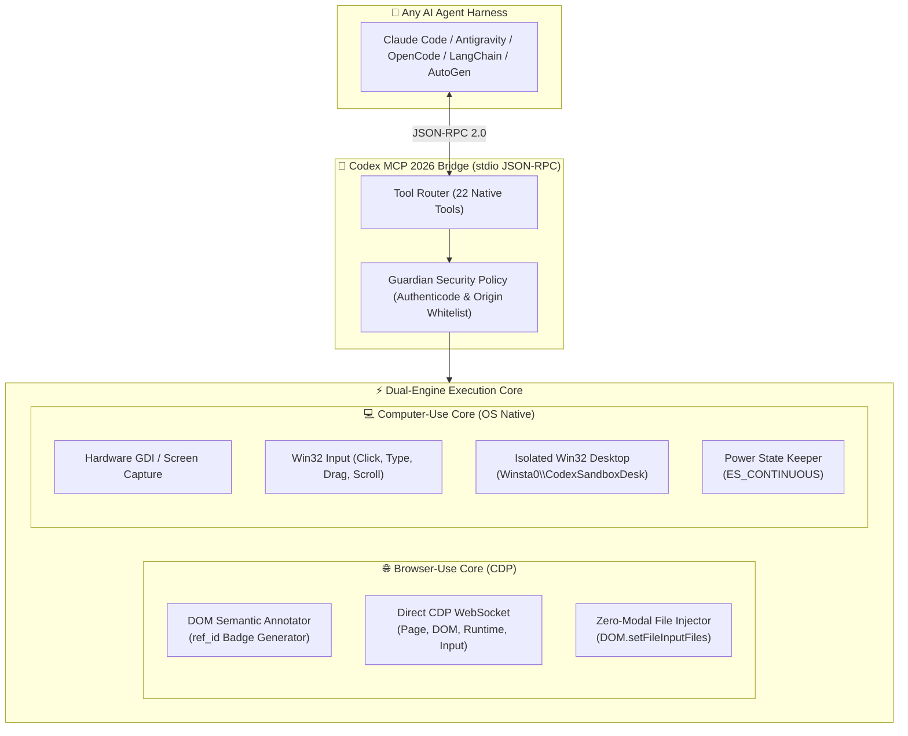

<div align="center">

# ⚡ Codex Computer-Use & Browser-Use Universal Harness

**The high-performance, deterministic automation engine extracted from OpenAI Codex's native Guardian v2 architecture.**

[](https://nodejs.org/)
[](https://modelcontextprotocol.io/)
[-success?style=for-the-badge)](https://nodejs.org/)
[](https://microsoft.com)
[](LICENSE)

*Say goodbye to coordinate hallucination, frozen file picker dialogs, and broken agent loops.*

[Key Innovations](#-the-breakthrough-why-traditional-computer-use-fails) •
[Architecture](#-system-architecture) •
[Quickstart](#-quickstart-in-30-seconds) •
[Agent Integration](#-agent-harness-integrations) •
[MCP Tool Catalog](#-mcp-tool-catalog-22-tools)

</div>

---

## 🎯 The Breakthrough: Why Traditional Computer-Use Fails

If you have ever watched an autonomous AI agent attempt to use a computer, you have seen it fail at the simplest tasks:
- **Pixel-Guessing Failure:** Agents take full-screen screenshots, guess `(x, y)` pixel coordinates with a vision model, click slightly off-target, and get stuck in infinite retry loops.
- **The Account Picker Trap:** On login screens (Google, Microsoft, X/Twitter), subtle UI shifts cause the vision model to click the wrong profile or miss the submit button.
- **The File Upload Freeze:** When an agent clicks "Upload" on Google Drive or MercadoLibre, the native OS file dialog opens as a modal window. The agent cannot interact with the Win32 file tree, freezing the entire execution.
- **Desktop Hijacking:** Standard desktop automation takes over the user's mouse and keyboard, making it impossible to work while the agent is running.

### 📊 Traditional Vision vs. Codex CUA Architecture

| Challenge | Traditional Vision Agents | Codex CUA Universal Harness |
| :--- | :--- | :--- |
| **Element Targeting** | ❌ Hallucinates pixel `(x, y)` coords | ✅ **Semantic DOM `ref_id`** with high-contrast badge overlays |
| **File Uploads (Drive, etc.)** | ❌ Trapped in native file dialog | ✅ **Direct CDP Injection** (`DOM.setFileInputFiles`) with zero modals |
| **Input Fields** | ❌ Blind clicks followed by keyboard typing | ✅ **Direct DOM Value Dispatch** (`browserFillRef`) with change events |
| **Workspace Isolation** | ❌ Steals user's mouse and screen | ✅ **Dedicated Win32 Desktop** (`Winsta0\CodexSandboxDesk`) |
| **System Sleep** | ❌ Machine sleeps during long jobs | ✅ **Native Win32 Power Assertion** (`SetThreadExecutionState`) |
| **Dependencies** | ❌ Heavy Python/Puppeteer/Docker bloat | ✅ **Zero dependencies** (built-in Node 24 WebSocket & fetch) |

---

## 🏗️ System Architecture



---

## ✨ Key Features

### 1. Semantic DOM Annotation (`browser_annotation_api`)
Instead of asking a vision model to calculate coordinates from downsampled pixels, the harness scans the active DOM tree, identifies every interactive element (buttons, links, inputs, dropdowns, ARIA roles), and injects numeric `ref_id` tags with high-visibility badges:
```javascript
// The agent receives a structured manifest:
[
  { "ref_id": 1, "tag": "button", "text": "Sign In", "box": { "x": 1020, "y": 35, "w": 80, "h": 32 } },
  { "ref_id": 2, "tag": "input", "type": "email", "placeholder": "Email address" }
]

// And clicks deterministically without coordinate guessing:
cua_browser_click_ref({ ref_id: 1 });
```

### 2. Zero-Modal File Uploading
Upload files to **Google Drive**, **MercadoLibre**, **Slack**, or any web application directly via CDP:
```javascript
cua_browser_upload({
  ref_id: 5,
  file_paths: ["G:\\Documents\\invoice_2026.pdf"]
});
```
The browser's native file picker dialog is never opened, eliminating freeze conditions completely.

### 3. Isolated Windows Desktop Sandbox
Run automated desktop jobs inside an isolated Win32 Desktop station (`Winsta0\CodexSandboxDesk`):
- Modal dialogs and message queues are isolated from your primary desktop.
- Your mouse and active windows remain untouched while the agent operates in the background.

### 4. Zero Dependencies
Built entirely on Node.js native standard libraries:
- Native `fetch` (HTTP JSON endpoints)
- Native `WebSocket` (CDP bidirectional connection)
- Native `child_process` (PowerShell Win32 P/Invoke bridge)
- No `npm install`, no external bloat, launches in under 50ms.

---

## ⚡ Quickstart in 30 Seconds

### Prerequisites
- [Node.js v22 or v24+](https://nodejs.org/)
- Windows 10/11 (for native desktop automation & sandbox; browser CDP works cross-platform)
- Any Chromium browser (Chrome, Edge, Brave) started with remote debugging:
  ```powershell
  chrome.exe --remote-debugging-port=9222
  ```

### Verify the Engine
```bash
git clone https://github.com/Owning01/codex-computer-use.git
cd codex-computer-use
node scripts/test_cua.js
```
*All 5 automated verification phases (Policy, Sleep Prevention, MCP Handshake, Clipboard Roundtrip, SearchCommands Batch) should pass in < 2 seconds.*

---

## 🔌 Agent Harness Integrations

### 1. Claude Code / Claude Desktop
Add to your `claude_desktop_config.json` or `.mcp.json`:
```json
{
  "mcpServers": {
    "codex-computer-use": {
      "command": "node",
      "args": [
        "G:\\Proyectos\\codex-computer-use\\scripts\\codex_mcp_server.js"
      ]
    }
  }
}
```

### 2. Antigravity / OpenCode
Add to your MCP configuration (`mcp_config.json`):
```json
{
  "mcpServers": {
    "codex-cua": {
      "command": "node",
      "args": ["G:/Proyectos/codex-computer-use/scripts/codex_mcp_server.js"]
    }
  }
}
```

### 3. Python (LangChain, AutoGen, CrewAI, Custom Harnesses)
```python
import subprocess
import json

class CodexCUA:
    def __init__(self, script_path="G:/Proyectos/codex-computer-use/scripts/codex_mcp_server.js"):
        self.proc = subprocess.Popen(
            ["node", script_path],
            stdin=subprocess.PIPE,
            stdout=subprocess.PIPE,
            text=True
        )
        self._rpc("initialize", {"protocolVersion": "2024-11-05", "capabilities": {}})

    def _rpc(self, method, params):
        msg = json.dumps({"jsonrpc": "2.0", "id": 1, "method": method, "params": params})
        self.proc.stdin.write(msg + "\n")
        self.proc.stdin.flush()
        return json.loads(self.proc.stdout.readline())

    def annotate_page(self):
        return self._rpc("tools/call", {"name": "cua_browser_annotate", "arguments": {}})

    def click_ref(self, ref_id):
        return self._rpc("tools/call", {"name": "cua_browser_click_ref", "arguments": {"ref_id": ref_id}})

    def fill_ref(self, ref_id, text):
        return self._rpc("tools/call", {"name": "cua_browser_fill_ref", "arguments": {"ref_id": ref_id, "text": text}})

    def upload_file(self, ref_id, paths):
        return self._rpc("tools/call", {"name": "cua_browser_upload", "arguments": {"ref_id": ref_id, "file_paths": paths}})
```

---

## 🧰 MCP Tool Catalog (22 Tools)

### 🌐 Browser & Web Navigation
| Tool | Description | Key Parameters |
| :--- | :--- | :--- |
| `cua_browser_connect` | Connects to Chrome/Edge via CDP | `port` (default: 9222) |
| `cua_browser_navigate` | Navigates the active tab to any URL | `url` |
| `cua_browser_screenshot` | Captures viewport screenshot as base64 PNG | None |
| `cua_browser_annotate` | **Generates `ref_id` tags & badge overlays for all interactables** | None |
| `cua_browser_click_ref` | Clicks any element deterministically by its `ref_id` | `ref_id` |
| `cua_browser_fill_ref` | Fills form input or textarea by `ref_id` with input/change events | `ref_id`, `text` |
| `cua_browser_upload` | Uploads local files directly into file inputs (Google Drive, etc.) | `ref_id`, `file_paths` |
| `cua_browser_eval` | Evaluates JavaScript in the active page and returns result | `expression` |

### 💻 Desktop OS Automation
| Tool | Description | Key Parameters |
| :--- | :--- | :--- |
| `cua_desktop_screenshot` | High-fidelity hardware GDI desktop capture | `output_path` (optional) |
| `cua_desktop_click` | Native mouse click at coordinates | `x`, `y`, `button`, `double_click` |
| `cua_desktop_mouse_move`| Moves mouse cursor without clicking (hover/tooltips) | `x`, `y` |
| `cua_desktop_scroll` | Smooth mouse wheel scroll | `delta_y`, `x`, `y` |
| `cua_desktop_drag` | Smooth interpolated mouse drag-and-drop | `start_x`, `start_y`, `end_x`, `end_y` |
| `cua_desktop_type` | Types text into the focused native window | `text` |
| `cua_desktop_key` | Sends keyboard shortcut (`Enter`, `Tab`, `Ctrl+A`, `Ctrl+C`, etc.) | `key` |
| `cua_clipboard_get` | Securely reads current system clipboard text | None |
| `cua_clipboard_set` | Sets system clipboard text | `text` |
| `cua_window_list` | Lists open top-level applications with PID and title | None |
| `cua_window_focus` | Brings any window to foreground | `query` |
| `cua_exec_sandboxed` | Spawns command in isolated `Winsta0\CodexSandboxDesk` | `command_line` |
| `cua_status` | Inspects Guardian security policy and connection state | None |

### ⚡ Batch Unified Protocol
| Tool | Description | Key Parameters |
| :--- | :--- | :--- |
| `cua_search_commands` | Executes unified multi-step Codex batch operations (`open`, `click`, `find`, `screenshot`, `time`) | `commands` |

---

## 🔒 Security: The Guardian Policy

The engine adheres to OpenAI Codex's Guardian v2 access control model defined in `config.example.toml`:
- **Authenticode Whitelisting:** Prevents unauthorized binary execution by validating digital signatures (`publisher_name`, `product_name`, `binary_name`).
- **Origin Scoping:** Confines automated browser actions to explicitly allowed domain patterns.
- **Upload / Download Gating:** Granular permission flags to protect sensitive enterprise environments.

---

## 📄 License

Licensed under the [Apache License, Version 2.0](LICENSE).
Built for open-source AI agent research and autonomous computer automation.
